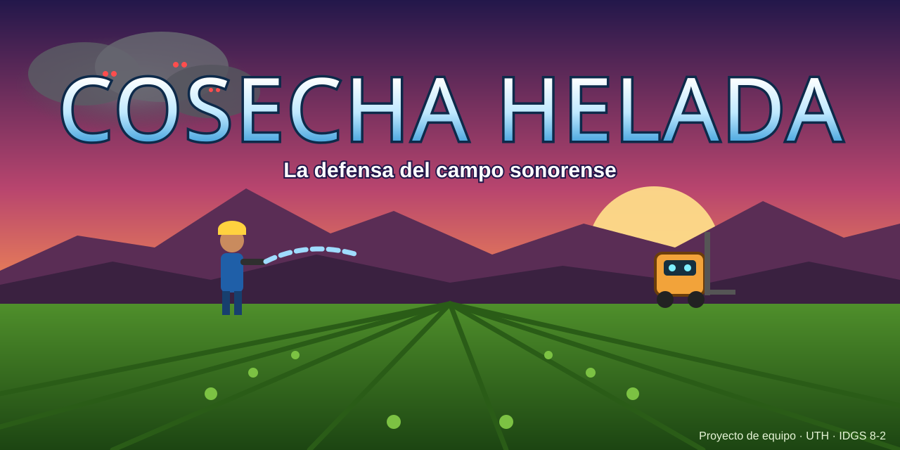
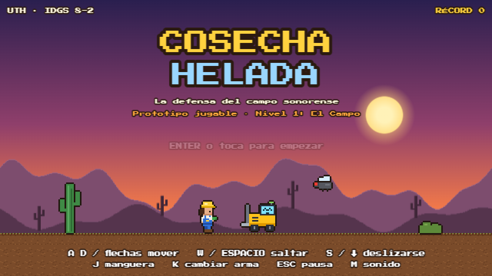
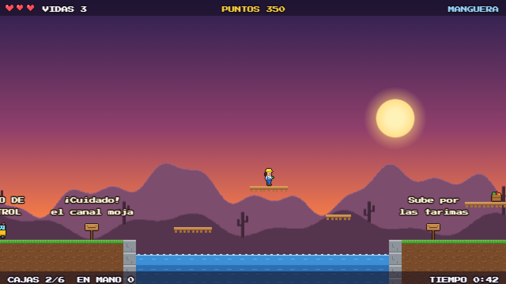
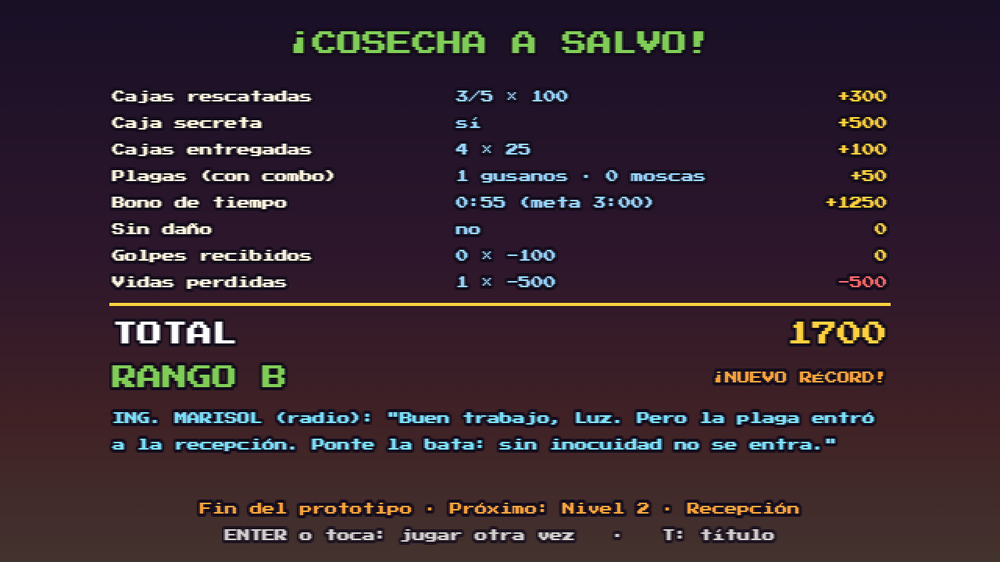

# Cosecha Helada · Portafolio de evidencias



Portafolio de equipo para la propuesta del videojuego **Cosecha Helada**: un juego de plataformas 2D para navegador. Una inspectora de calidad y su robot montacargas rescatan la cosecha del Valle de Hermosillo de una plaga gris y la llevan a tiempo a la planta congeladora.

## 🎮 Jugar el prototipo

**👉 [Jugar en línea](https://joeljorex.github.io/cosecha-helada-portafolio/)**: Nivel 1 · El Campo, hecho con Phaser 3. Funciona en PC y en celular.

| Título | Nivel 1 | Resultados |
|:---:|:---:|:---:|
|  |  |  |

| Acción | Teclado | Celular |
|---|---|---|
| Moverse | A D / flechas | ◀ ▶ |
| Saltar (mantén para subir más) | W / Espacio | ⤒ |
| Deslizarse (corriendo) | S / ↓ | ▼ |
| Disparar | J | 💧 |
| Cambiar arma | K | ⇄ |
| Pausa / sonido | Esc o P / M | ⏸ / 🔊 |

**Lo que trae el prototipo:** intro con el guion del GDD, salto variable, deslizarse, manguera y rociador, gusanos que salen del surco y escupen, moscas que bajan en picada, 5 cajas y 1 caja secreta, Tarimín como punto de control, canal de riego con tarima flotante, camión de meta, puntaje con combo y rango (GDD §17), música y efectos generados con Web Audio y récord guardado en el navegador.

## 📋 Datos

| | |
|---|---|
| **Escuela / grupo** | Universidad Tecnológica de Hermosillo (UTH) · IDGS 8-2 |
| **Materia / docente** | _(completar)_ |
| **Tipo de trabajo** | Portafolio de evidencias en equipo, a partir de un caso práctico |
| **Estado** | Preproducción terminada y prototipo jugable del Nivel 1 publicado |

## 📂 Evidencias

| Evidencia | Archivo |
|---|---|
| 📘 **Documento de Diseño de Juego (GDD)** | [docs/GDD.md](docs/GDD.md) |
| 🖥️ **Documento técnico: hardware y software** | [docs/Documento_tecnico_requerimientos.md](docs/Documento_tecnico_requerimientos.md) |
| 🗂️ **Proyecto en GitHub (tarjetas)** | _(enlace al tablero de GitHub Projects)_ |
| 🎮 **Prototipo jugable del Nivel 1** | [juego/](juego/) · [jugar en línea](https://joeljorex.github.io/cosecha-helada-portafolio/) |
| 🗺️ Mapa del Nivel 1 (boceto) | [img/mapa_nivel1.svg](img/mapa_nivel1.svg) |
| 🎬 Storyboard de la intro | [img/storyboard.svg](img/storyboard.svg) |

## 👥 Integrantes

| Foto | Nombre | Rol |
|:---:|---|---|
|  | Joel Armando Ibarra Rubalcava | Programación, Git y diseño de niveles |
|  | Jorge Humberto Martínez Delgado | Arte, audio, QA y documentación |

## 🎮 El juego en breve

- **Género:** plataformas 2D de acción con recolección.
- **Público:** 10 a 25 años (E10+), PC y celular.
- **Niveles:** El Campo → Recepción → Túnel IQF → Cámara fría −25 °C → Andén de embarque.
- **Armas:** manguera a presión, rociador orgánico, lanzador IQF (congela) y red cosechadora.
- **Vestimenta con efecto:** botas antiderrapantes, bata y cofia de inocuidad, traje térmico y casco con lámpara.
- **Score:** puntos por evento con combo de hasta ×3, bono de tiempo y bono sin daño (ver [GDD §17](docs/GDD.md#17-score-cálculo-sobre-los-eventos)).
- **Stack:** Phaser 3, Tiled, Aseprite/LibreSprite, BeepBox, jsfxr, GitHub Pages.

## 🗂️ Tarjetas del proyecto

El trabajo se organiza en **GitHub Projects**: cada tarea es un *issue* con su etiqueta (`documentación`, `diseño`, `arte`, `audio`, `programación`, `git`) y su sprint. Las columnas son **Por hacer → En progreso → Hecho**.

Las tarjetas están en [tarjetas/tarjetas.json](tarjetas/tarjetas.json). El script [tarjetas/crear_tarjetas.ps1](tarjetas/crear_tarjetas.ps1) las crea en GitHub con un solo comando (requiere `gh auth refresh -s project`).

## 🌿 Flujo de Git

`main` (protegida y publicada) ← `develop` ← `feature/<núm-tarjeta>-<descripción>`. Los commits usan el formato *Conventional Commits* con el número de tarjeta, por ejemplo `feat(nivel1): agrega tarima flotante (#14)`. Los *pull requests* llevan al menos una revisión. El detalle está en el [GDD §18](docs/GDD.md#18-propuesta-de-plan-de-trabajo).

## 📁 Estructura

```
cosecha-helada-portafolio/
├── README.md
├── index.html          # redirige al prototipo (GitHub Pages)
├── docs/
│   ├── GDD.md
│   └── Documento_tecnico_requerimientos.md
├── img/                # splash, mapa del nivel 1, storyboard, capturas y fotos
├── juego/              # prototipo jugable en Phaser 3
│   ├── index.html
│   ├── css/estilo.css
│   └── js/             # audio, arte, nivel1, escenas, juego y main
├── tarjetas/           # tarjetas del tablero y script para crearlas
└── LICENSE             # MIT
```

**Cómo correrlo en tu computadora:** abre una terminal en la carpeta del repositorio, ejecuta `python -m http.server 8000` y entra a `http://localhost:8000/juego/`. Phaser y la fuente se cargan por Internet.

## 📄 Licencia

El código del prototipo se publica con licencia [MIT](LICENSE).

---

*Proyecto escolar. Personajes, empresa y hechos ficticios.*
