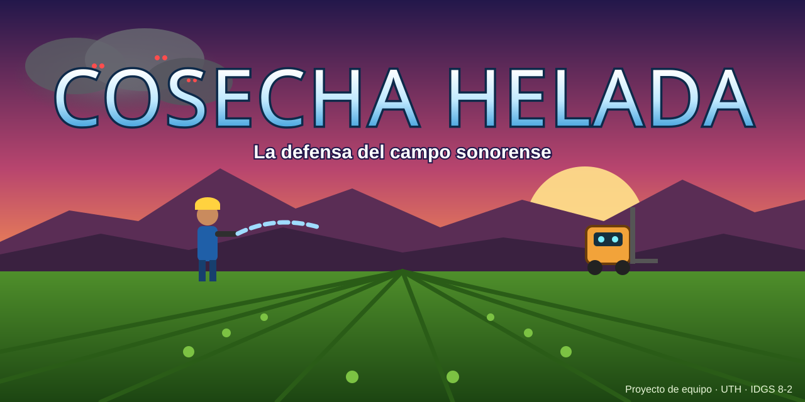
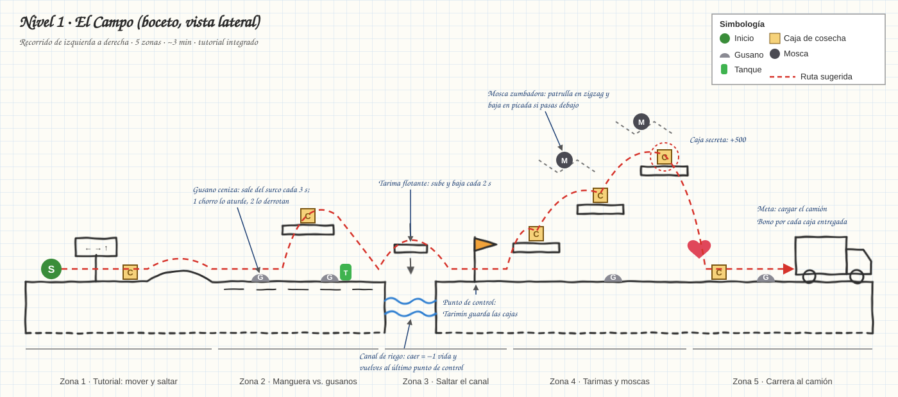
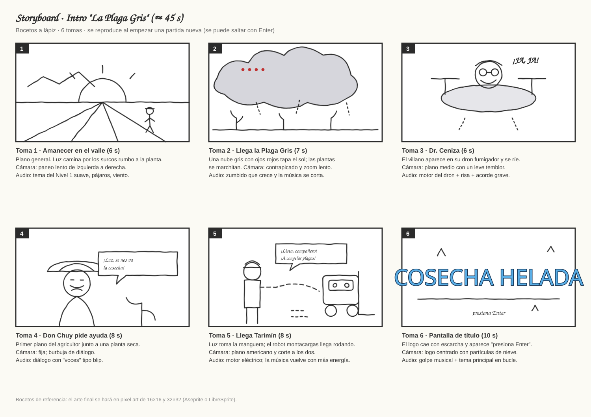

# Documento de Diseño de Juego (GDD) · COSECHA HELADA



## Portada

| | |
|---|---|
| **Juego** | Cosecha Helada · *La defensa del campo sonorense* |
| **Escuela** | Universidad Tecnológica de Hermosillo (UTH) |
| **Grupo** | IDGS 8-2 |
| **Materia** | _(completar)_ |
| **Docente** | _(completar)_ |
| **Fecha** | Noviembre 2026 · versión 1.0 del GDD (formato *Lean*) |

### Integrantes

| Foto | Nombre | Rol principal |
|:---:|---|---|
|  | Joel Armando Ibarra Rubalcava | Programación, Git y diseño de niveles (líder técnico) |
|  | Jorge Humberto Martínez Delgado | Arte, audio (música y efectos), QA y documentación |

> Para poner las fotos: súbanlas a `img/integrantes/` (por ejemplo `joel.jpg`) y cambien `foto_pendiente.svg` por el nombre del archivo.

### Enlaces

| | |
|---|---|
| **Repositorio** | https://github.com/joeljorex/cosecha-helada-portafolio |
| **Prototipo jugable (Nivel 1)** | https://joeljorex.github.io/cosecha-helada-portafolio/ |
| **Proyecto (tablero de tarjetas)** | _(se agrega el enlace al crear el tablero en GitHub Projects)_ |
| **Documento técnico** | [Documento_tecnico_requerimientos.md](Documento_tecnico_requerimientos.md) |

---

## 1. Resumen

**Concepto en una línea:** un juego de plataformas 2D donde una inspectora de calidad y su robot montacargas rescatan la cosecha de Sonora de una plaga gris, la congelan y la llevan a tiempo a la planta.

**Pilares de diseño**
1. **Rescatar, no solo destruir.** El objetivo principal es salvar cajas de cosecha. Derrotar enemigos ayuda, pero no es el fin.
2. **El frío como herramienta y como amenaza.** Congelas enemigos para usarlos de plataforma, pero en la cámara fría el frío también te daña a ti.
3. **Identidad local.** Campos, canales de riego, cerros y una planta congeladora del desierto sonorense.

---

## 2. Género

**Plataformas 2D de acción** (*run & gun* ligero) con recolección y pequeños acertijos de entorno. Avance lateral por niveles, con vista de lado y cámara que sigue al jugador.

## 3. Público objetivo

| Aspecto | Definición |
|---|---|
| Edad | 10 a 25 años (clasificación sugerida **E10+**: acción caricaturesca, sin sangre) |
| Perfil | Jugadores casuales y *mid-core* que disfrutan de los plataformas clásicos y las partidas cortas |
| Plataforma | Navegador web en PC (teclado o control) y celular (controles táctiles) |
| Sesión típica | 10 a 20 minutos. Cada nivel dura de 3 a 5 minutos |

## 4. Plataforma y tecnología

**Phaser 3** (JavaScript) + **Tiled** para los mapas. Se publica en **GitHub Pages**. Resolución base de 640×360, escalada a pantalla completa, a 60 FPS. El detalle de hardware y software está en el [documento técnico](Documento_tecnico_requerimientos.md).

**Prototipo del Nivel 1 (ya jugable):** está en la carpeta [`juego/`](../juego/) y se juega en https://joeljorex.github.io/cosecha-helada-portafolio/. Usa Phaser 3 con física *arcade*. Por ahora el mapa se arma por código (`juego/js/nivel1.js`), los sprites se dibujan con código como arte provisional y la música y los efectos se generan con Web Audio. En los siguientes sprints se cambian por el mapa de Tiled, el pixel art final y las pistas de BeepBox.

---

## 5. Historia

**Premisa.** Es temporada de cosecha en el Valle de Hermosillo. El **Dr. Ceniza**, un químico despedido por usar fertilizantes peligrosos, libera **La Plaga Gris**: una nube de insectos mutantes que marchita todo lo que toca. Si la cosecha no entra al túnel de congelación antes del anochecer, se pierde toda la temporada.

**Arco**
- **Inicio:** Luz Rubio, inspectora de calidad de la planta congeladora *Frío del Desierto* (empresa ficticia), recibe el aviso de Don Chuy. Con una manguera y la ayuda de Tarimín, sale a rescatar las cajas del campo.
- **Desarrollo:** Luz sigue el rastro de la plaga hasta la planta: la recepción de materia prima, el túnel IQF y la cámara de congelación. En el camino descubre que el Dr. Ceniza quiere contaminar el embarque para arruinar a todos los productores del valle.
- **Clímax:** en el andén de embarque, Luz enfrenta al Dr. Ceniza y a su dron fumigador gigante, **la Reina Gris**.
- **Final:** la Reina Gris queda congelada, el último tráiler sale a tiempo y Don Chuy celebra la cosecha. Escena posterior a los créditos: una mosca gris escapa por la ventila…

---

## 6. Personajes

| Personaje | Rol | Descripción | Habilidades / comportamiento |
|---|---|---|---|
| **Luz Rubio** | Protagonista (jugable) | 22 años, inspectora de calidad. Lista, valiente y algo terca. Usa casco amarillo y overol azul. | Corre, salta, se desliza y usa las armas. Tiene 3 corazones de vida y una barra de temperatura. |
| **Tarimín** | Compañero (apoyo) | Robot montacargas pequeño y entusiasta. Habla con pitidos traducidos en pantalla. | Es el punto de control: guarda las cajas rescatadas y da pistas. En el nivel 2 sirve como plataforma móvil. |
| **Don Chuy** | Mentor | Agricultor veterano con sombrero y bigote blanco. | Da el tutorial y las misiones del campo. |
| **Ing. Marisol** | Jefa de planta | Seria pero justa. Coordina desde el radio. | Explica los objetivos entre niveles. |
| **Dr. Ceniza** | Villano | Químico resentido, con lentes de soldador y bata manchada. | Aparece en las cinemáticas y pelea en el jefe final. |
| **La Reina Gris** | Jefa final | Dron fumigador gigante con la colmena de la plaga dentro. | Tres fases: lluvia de esporas, embestida y nube de insectos. |

**Enemigos**

| Enemigo | Nivel | Comportamiento | Vida |
|---|---|---|---|
| Gusano ceniza | 1–2 | Sale del surco cada 3 s y escupe una bolita gris en línea recta | 2 |
| Mosca zumbadora | 1–3 | Patrulla en zigzag; si pasas debajo, baja en picada | 1 |
| Rata de bodega | 2 | Corre por las bandas transportadoras y se roba las cajas que no recoges a tiempo | 3 |
| Hongo de humedad | 3 | Fijo. Suelta esporas que te frenan | 2 |
| Escarcha | 4 | Espectro de hielo que solo se ve con la lámpara del casco | 3 |
| Gusano tolva (mini-jefe) | 2 | Sale de la tolva de recepción; se le pega en la boca abierta | 20 |

---

## 7. Mecánicas principales

| Mecánica | Descripción |
|---|---|
| Movimiento | Correr, saltar (salto variable según cuánto se presione), deslizarse por debajo de obstáculos |
| Disparo | Cada arma tiene su propio efecto (ver [Armas](#9-armas)) |
| Congelar | El lanzador IQF congela al enemigo 4 s: se vuelve una plataforma de hielo, y si lo golpeas se rompe y da el doble de puntos |
| Rescate | Las cajas de cosecha se recogen y se entregan a Tarimín en los puntos de control |
| Temperatura | En los niveles 3 y 4 baja una barra de frío; se recupera con termómetros o con el traje térmico |
| Vidas | 3 corazones por vida y 3 vidas por partida. Al perder una vida vuelves al último punto de control |

**Controles**

| Acción | Teclado | Control | Celular |
|---|---|---|---|
| Moverse | ← → / A D | Palanca izquierda | Botones ← → |
| Saltar | Espacio / W | A | Botón ⤒ |
| Disparar | J | X | Botón 💧 |
| Cambiar arma | K | Y | Tocar el ícono del arma |
| Deslizarse | ↓ / S | B | Deslizar el dedo hacia abajo |
| Pausa | Esc | Start | Botón ⏸ |

---

## 8. Niveles

| # | Nivel | Ambientación | Mecánica nueva | Enemigos | Cierre del nivel |
|---|---|---|---|---|---|
| 1 | **El Campo** | Surcos al amanecer, cerros de fondo, canales de riego | Tutorial: mover, saltar, manguera, rescatar cajas | Gusano ceniza, mosca | Cargar el camión |
| 2 | **Recepción** | Nave de recepción: bandas, básculas, tolvas | Bandas transportadoras y básculas que abren puertas con peso | Rata de bodega, mosca | Mini-jefe: gusano tolva |
| 3 | **Túnel IQF** | Túnel con vapor frío y piso de acero escarchado | Piso resbaloso, chorros de aire que empujan, lanzador IQF | Hongo, mosca congelada | Escape por la banda de salida |
| 4 | **Cámara fría −25 °C** | Racks de tarimas, oscuridad, luz azul | Oscuridad (lámpara del casco), barra de temperatura | Escarcha | Encender el generador |
| 5 | **Andén de embarque** | Noche, tráileres refrigerados, luces de patio | Todas las anteriores | Todos + Dr. Ceniza | Jefe final: la Reina Gris |

### Mapa del Nivel 1 (boceto) y comportamiento general



- **Zona 1 (tutorial):** letreros enseñan a moverse y saltar. Hay una caja fácil de tomar para aprender a recoger.
- **Zona 2:** aparecen los gusanos. La manguera los aturde con 1 chorro y los derrota con 2. Hay una caja sobre una tarima y un tanque verde de rociador.
- **Zona 3:** el canal de riego. Una tarima flotante sube y baja cada 2 s. Si caes, pierdes una vida y vuelves al punto de control de Tarimín.
- **Zona 4:** escalera de tarimas con moscas en zigzag. Arriba hay una **caja secreta** (+500).
- **Zona 5:** carrera al camión con un botiquín y un último gusano. Al llegar se cuentan las cajas y se da el bono.

---

## 9. Armas

| Arma | Cómo se obtiene | Efecto | Munición |
|---|---|---|---|
| **Manguera a presión** | Inicial | Chorro recto que aturde y empuja | Ilimitada |
| **Rociador orgánico** | Nivel 1, zona 2 | Nube en área que daña a varios enemigos a la vez | Tanques verdes (10 usos cada uno) |
| **Lanzador IQF** | Nivel 3 | Congela al enemigo 4 s y lo vuelve plataforma | Cristales de hielo (5 por recarga) |
| **Red cosechadora** | Nivel 2 | Golpe cercano. Atrapa moscas y recupera las cajas que se robaron las ratas | Ilimitada (espera de 1 s entre golpes) |

## 10. Vestimenta

La ropa se ve en el personaje y cambia cómo se juega.

| Vestimenta | Dónde se consigue | Efecto en el juego |
|---|---|---|
| **Overol de campo** | Inicial | Ninguno (equipo base) |
| **Botas antiderrapantes** | Nivel 3, al inicio | Ya no resbalas en el hielo |
| **Bata y cofia de inocuidad** | Nivel 2, en el filtro sanitario | Permite entrar a las zonas de proceso. +10 % de puntos por "higiene" |
| **Traje térmico** | Nivel 4, en el casillero | La temperatura baja a la mitad de velocidad |
| **Casco con lámpara** | Nivel 4 | Ilumina un cono al frente y revela a las escarchas |

## 11. Objetos especiales

**Props e interactivos**

| Objeto | Función |
|---|---|
| Caja de cosecha | Coleccionable principal (+100). Las secretas valen +500 |
| Termómetro | Recupera la barra de temperatura |
| Botiquín | Recupera 1 corazón |
| Tanque verde / cristal de hielo | Munición del rociador / del lanzador IQF |
| Tarimas | Plataformas fijas, flotantes o que se caen |
| Bandas transportadoras | Mueven al jugador y a los enemigos |
| Básculas | Interruptores que se activan con peso (Luz, cajas o enemigos congelados) |
| Cortinas de tiras | Separan las zonas y marcan los puntos de control |

**Fondos (*backgrounds*)**, con capas de *parallax*:
1. Campo al amanecer: cielo naranja y morado, cerros del desierto y surcos.
2. Nave de recepción: estructura metálica, tolvas y lámparas industriales.
3. Túnel IQF: vapor, acero inoxidable y luces cian.
4. Cámara fría: racks de tarimas, escarcha en las paredes y oscuridad.
5. Andén: noche, tráileres, reflectores y las luces de la ciudad a lo lejos.

## 12. Arte

- **Estilo:** pixel art con sprites de 32×32 para los personajes, *tiles* de 16×16 y contornos oscuros.
- **Paleta:** cálida para el campo (naranja, verde, café) y fría para la planta (cian, azul, blanco). El gris de la plaga contrasta en los dos ambientes.
- **Animaciones de Luz:** reposo (4 cuadros), correr (6), saltar (3), disparar (3), daño (2) y deslizarse (2).
- **Interfaz:** corazones arriba a la izquierda, arma y munición arriba a la derecha, contador de cajas y barra de temperatura abajo.

---

## 13. Storyboard (bocetos)



## 14. Guion

**Intro (tomas 1 a 6 del storyboard)**

> *Amanecer. Pájaros. Luz camina entre los surcos.*
> **LUZ:** Otra temporada récord, Tarimín. Hoy no se nos escapa ni una calabacita.
> *Un zumbido crece. Una nube gris tapa el sol.*
> **DR. CENIZA** *(desde su dron)*: ¡Ja, ja! ¡Que disfruten su última cosecha! ¡Mi plaga va a dejar este valle en cenizas!
> **DON CHUY:** ¡Luz! ¡Se nos va la cosecha! Hay que meter todo al túnel antes de que anochezca.
> **LUZ** *(toma la manguera)*: Entonces no hay tiempo que perder. ¿Listo, compañero?
> **TARIMÍN:** ¡Bip-bip! *(Traducción: "¡Listo! ¡A congelar plagas!")*
> *Aparece el logo: COSECHA HELADA.*

**Entre niveles (por radio, Ing. Marisol)**
- *Después del 1:* "Buen trabajo, Luz. Pero la plaga entró a la recepción. Ponte la bata: sin inocuidad no se entra."
- *Después del 2:* "El túnel IQF está fuera de control. Lleva el lanzador de hielo y cuidado con el piso."
- *Después del 3:* "La cámara está a −25 °C y sin luz. Ponte el traje térmico."
- *Después del 4:* "Ceniza está en el andén. Es ahora o nunca."

**Final**

> **DR. CENIZA:** ¡No puede ser! ¡Mi Reina… congelada!
> **LUZ:** Aquí todo se congela a tiempo, doctor. Hasta los problemas.
> *Sale el último tráiler. Don Chuy y la Ing. Marisol aplauden. Tarimín baila.*
> **DON CHUY:** ¡Esta cosecha se va a contar por años!
> *Créditos. Escena final: una mosca gris escapa por la ventila…*

---

## 15. Música

Música original hecha por el equipo en **BeepBox** (chiptune) y exportada a `.ogg`/`.mp3`. Si se usa música de terceros, solo con licencia **CC0 o CC-BY** (por ejemplo de OpenGameArt), dando crédito.

| Pista | Dónde suena | Estilo | Tempo | Ambiente |
|---|---|---|---|---|
| "Temporada" | Menú y créditos | Chiptune con aire norteño (melodía tipo acordeón en onda cuadrada) | 120 BPM | Alegre, con ganas de jugar |
| "Amanecer en el surco" | Nivel 1 | Chiptune con bajo de tololoche | 120 BPM | Aventura ligera |
| "Banda sin fin" | Nivel 2 | Funk mecánico con percusión metálica | 110 BPM | Rítmica e industrial |
| "Vapor y escarcha" | Nivel 3 | Arpegios de sintetizador y campanas | 95 BPM | Fría y misteriosa |
| "Menos veinticinco" | Nivel 4 | Pads oscuros con poca percusión | 80 BPM | Tensa, de sigilo |
| "Último embarque" | Nivel 5 y jefe | Épica rápida con la melodía principal en tono menor | 140 BPM | Urgente |
| *Jingle* de victoria / derrota | Fin de nivel / *game over* | Fanfarria de 3 s / melodía descendente | — | — |

## 16. Efectos de audio

Se generan con **jsfxr** o **ChipTone** (gratis) y se editan en **Audacity**.

| Evento | Efecto | Archivo |
|---|---|---|
| Saltar | "Bloop" ascendente corto | `sfx_salto.wav` |
| Disparo de manguera | Chorro de agua (ruido filtrado) | `sfx_manguera.wav` |
| Rociador | "Psshh" largo | `sfx_rociador.wav` |
| Congelar | Cristal que se forma (barrido agudo) | `sfx_congelar.wav` |
| Romper hielo | Cristal que se rompe | `sfx_romper.wav` |
| Recoger caja | Moneda de dos notas | `sfx_caja.wav` |
| Entregar cajas a Tarimín | Arpegio + pitido del robot | `sfx_entrega.wav` |
| Recibir daño | Golpe grave + parpadeo | `sfx_dano.wav` |
| Enemigo derrotado | "Puff" | `sfx_derrota.wav` |
| Báscula / puerta | Clic metálico + motor | `sfx_puerta.wav` |
| Frío extremo | Viento helado en bucle | `amb_frio.ogg` |
| Jefe aparece | Alarma + acorde grave | `sfx_jefe.wav` |

---

## 17. Score (cálculo sobre los eventos)

| Evento | Puntos |
|---|---|
| Rescatar una caja de cosecha | +100 |
| Caja secreta | +500 |
| Entregar cajas a Tarimín | +25 por caja entregada |
| Gusano ceniza / mosca / rata / hongo / escarcha | +50 / +75 / +100 / +80 / +150 |
| Congelar y romper a un enemigo | ×2 sobre el valor del enemigo |
| Mini-jefe / jefe final | +2,000 / +5,000 |
| Bono de tiempo | +10 por segundo por debajo del tiempo objetivo del nivel |
| Nivel sin recibir daño | +1,000 |
| Recibir daño | −100 |
| Perder una vida | −500 |

**Combo:** si derrotas a un enemigo menos de 2 s después del anterior, el multiplicador sube: ×1 → ×1.5 → ×2 → ×3 (máximo). Se reinicia al recibir daño.

**Fórmula por nivel**

```
Puntaje = Σ (puntos del evento × combo)
        + 25 × cajas entregadas
        + 10 × max(0, tiempo objetivo − tiempo real)
        + 1000 × (sin daño ? 1 : 0)
        − 100 × golpes recibidos
        − 500 × vidas perdidas
```

**Ejemplo (Nivel 1, tiempo objetivo 180 s):**

| Concepto | Puntos |
|---|---|
| 5 cajas normales | 500 |
| 1 caja secreta | 500 |
| 6 cajas entregadas a Tarimín (6 × 25) | 150 |
| 4 gusanos (4 × 50) | 200 |
| 2 moscas seguidas: 75 + 75 × 1.5 de combo (se redondea) | 188 |
| Bono de tiempo: terminó en 150 s (30 × 10) | 300 |
| 1 golpe recibido | −100 |
| **Total** | **1,738** |

**Rango al final del nivel:** S ≥ 2,500 · A ≥ 1,800 · B ≥ 1,200 · C < 1,200 (los valores se escalan en cada nivel).

---

## 18. Propuesta de plan de trabajo

### Calendario (8 semanas, *sprints* de 1 semana)

| Semana | Sprint | Entregables |
|---|---|---|
| 1 | Preproducción | GDD v1, documento técnico, repositorio, tablero de tarjetas, reglas de Git |
| 2 | Prototipo | Movimiento y salto en Phaser, cámara, mapa gris del Nivel 1 en Tiled |
| 3 | Mecánicas | Manguera, gusanos y moscas, cajas y puntos de control |
| 4 | Nivel 1 completo | Arte del campo, HUD, score y sonidos básicos |
| 5 | Nivel 2 | Bandas, básculas, rata y mini-jefe; música de los niveles 1 y 2 |
| 6 | Niveles 3 y 4 | Hielo, lanzador IQF, temperatura, oscuridad y vestimenta |
| 7 | Nivel 5 y jefe | La Reina Gris, cinemáticas, música restante |
| 8 | Cierre | Pruebas, corrección de errores, versión 1.0, video y presentación |

### Plan técnico de Git

- **Repositorio:** `docs/` (GDD y documento técnico), `img/` (arte de documentación y capturas) y `juego/` (prototipo jugable del Nivel 1). Cuando crezca el desarrollo se agregan `assets/` (sprites y audio finales) y `mapas/` (JSON de Tiled).
- **Ramas:**
  - `main`: protegida, solo se actualiza por *pull request* y es la que se publica en GitHub Pages.
  - `develop`: integración.
  - `feature/<núm-tarjeta>-<descripción>` (ej. `feature/12-manguera`), `fix/<núm>-<descripción>` y `docs/<descripción>`.
- **Commits:** formato *Conventional Commits* con número de tarjeta: `feat(nivel1): agrega tarima flotante (#14)`, `fix(hud): corrige contador de cajas`, `docs(gdd): actualiza score`.
- **Pull requests:** al menos 1 revisión de otro integrante y *squash merge*. Escribir `Closes #14` cierra la tarjeta sola.
- **Tarjetas:** cada tarea es un *issue* con etiqueta (`documentación`, `arte`, `audio`, `programación`, `diseño`) y *milestone* por sprint. El tablero de GitHub Projects tiene las columnas *Por hacer → En progreso → Hecho*.
- **Versiones:** etiquetas `v0.1.0` (prototipo), `v0.5.0` (alfa con 3 niveles) y `v1.0.0` (entrega).
- **Archivos pesados:** los fuentes de arte y audio (`.aseprite`, `.wav`) van con Git LFS o se exportan comprimidos (`.png`, `.ogg`).

```bash
git checkout develop && git pull
git checkout -b feature/12-manguera
# ...cambios...
git add . && git commit -m "feat(armas): agrega manguera a presión (#12)"
git push -u origin feature/12-manguera
gh pr create --base develop --fill
```

---

## 19. Créditos

| Área | Responsable |
|---|---|
| Dirección del proyecto, programación y diseño de niveles | Joel Armando Ibarra Rubalcava |
| Arte, personajes y escenarios | Jorge Humberto Martínez Delgado |
| Música y efectos de sonido | Jorge Humberto Martínez Delgado |
| QA y documentación | Jorge Humberto Martínez Delgado y Joel Armando Ibarra Rubalcava |
| Docente asesor | _(completar)_ |

**Herramientas:** Phaser 3, Tiled, Aseprite/LibreSprite, BeepBox, jsfxr, Audacity, Visual Studio Code, Git y GitHub.
**Recursos de terceros en el prototipo:** Phaser 3 (licencia MIT) y la fuente *Press Start 2P* de CodeMan38 (SIL Open Font License), cargada desde Google Fonts.
**Agradecimientos:** UTH, grupo IDGS 8-2 y a los productores del valle que inspiraron la historia.

*Cosecha Helada es un proyecto escolar. Los personajes, la empresa "Frío del Desierto" y los hechos son ficticios.*
